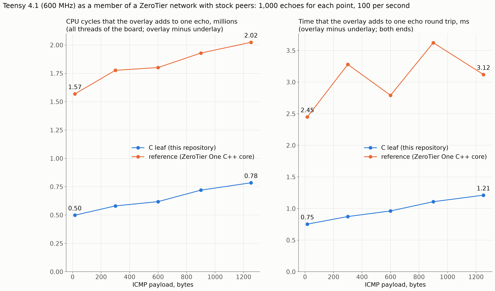
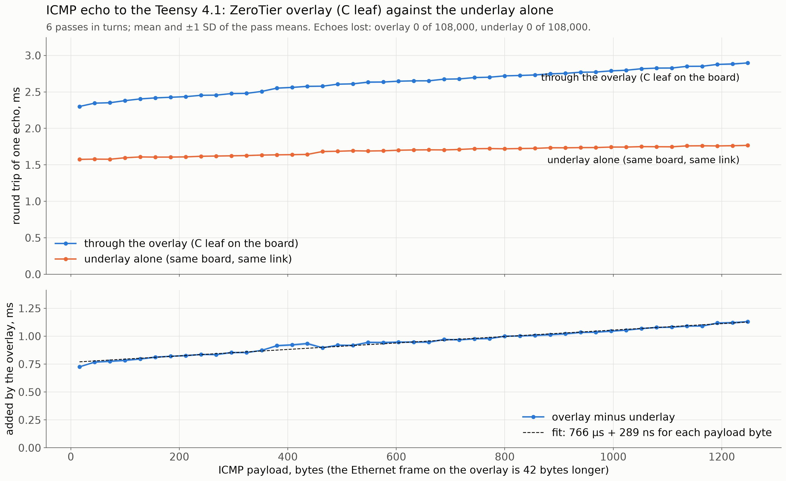

# Performance

Measured on one board: Teensy 4.1 (NXP i.MX RT1062, Cortex-M7 at 600 MHz, code runs from flash), Zephyr 4.4.2, `-Os`, as a member of a ZeroTier network with a stock 1.16.2 controller and stock 1.16.2 peers. The underlay is the board's USB network link to a Linux host that is itself a member. State: 2026-11-14. These are measurements, not proofs: one board, one network, one day. The proofs say nothing about time ([NOT_PROVEN.md](NOT_PROVEN.md), N-36).

Two solutions are compared in the same application, with the same board identity, the same network and the same peers: this leaf, and the reference solution (the restricted ZeroTier One 1.16.2 C++ core as a Zephyr module). The two do different work on the wire: this leaf announces protocol version 11, so stock peers use Salsa20/12 + Poly1305 with it; the reference announces version 13 and uses AES-GMAC-SIV in software.

## Cycles inside the leaf for one packet

Counted on the board around each call of the leaf (system cycle counter, 600,000,000 for each second; whatever interrupted the call is included); the average of 3,000 echoes for each size. `ztl status` on the board prints these counters.

```yaml
- payload_bytes: 16
  receive_one_frame: "45,000 cycles (75 µs): ztl_input() classifies, authenticates, decrypts, hands the frame over"
  send_one_frame: "30,000 cycles (50 µs): ztl_frame_to() builds the packet, encrypts, adds the authentication code"
- payload_bytes: 600
  receive_one_frame: "76,000 cycles (126 µs)"
  send_one_frame: "60,000 cycles (100 µs)"
- payload_bytes: 1,252
  receive_one_frame: "113,000 cycles (189 µs)"
  send_one_frame: "97,000 cycles (161 µs)"
```

That is about 55 cycles for each payload byte in each direction, on top of about 44,000 (receive) and 29,000 (send) for a packet of any size. The code is written for the provers (no shifts and masks in the cryptography, see [PROOFS.md](PROOFS.md#attempts-on-the-cryptography)) and is not tuned for speed; it runs from flash.

## Cost of the overlay for one echo, against the reference

Method: an ICMP echo to the board's overlay address and the same echo to its underlay address, 1,000 for each payload size, 100 for each second. Before and after each run the cycle totals of all threads of the board are read (the idle thread left out). "Added" is overlay minus underlay: what the board spends for one request and one reply because they travel through ZeroTier. It holds the ZeroTier code, its adapter, and the second pass of each packet through the network stack and the USB link. One pass of 1,000 echoes for each point; no error bars.



```yaml
- payload_bytes: 16
  leaf_cycles_added: 498,892
  reference_cycles_added: 1,569,027
  ratio: "3.1"
  leaf_ms_added: 0.75
  reference_ms_added: 2.45
- payload_bytes: 300
  leaf_cycles_added: 580,641
  reference_cycles_added: 1,776,999
  ratio: "3.1"
  leaf_ms_added: 0.87
  reference_ms_added: 3.28
- payload_bytes: 600
  leaf_cycles_added: 618,627
  reference_cycles_added: 1,801,313
  ratio: "2.9"
  leaf_ms_added: 0.96
  reference_ms_added: 2.79
- payload_bytes: 900
  leaf_cycles_added: 719,848
  reference_cycles_added: 1,929,286
  ratio: "2.7"
  leaf_ms_added: 1.11
  reference_ms_added: 3.62
- payload_bytes: 1252
  leaf_cycles_added: 784,717
  reference_cycles_added: 2,023,955
  ratio: "2.6"
  leaf_ms_added: 1.21
  reference_ms_added: 3.12
```

Which threads the added cycles are in (the four largest; `ztl` is this leaf's thread, `grey_zerotier` the reference's; `rx_q` and `tx_q` are the network stack's queues; this leaf encrypts in the thread that sends, so that work is in `tx_q`):

```yaml
- image: leaf
  payload_bytes: 16
  added_by_thread: "tx_q[0] 204,504; ztl 158,379; rx_q[0] 96,183; udc_work_q 21,927"
- image: reference
  payload_bytes: 16
  added_by_thread: "grey_zerotier 1,048,517; rx_q[0] 250,474; tx_q[0] 182,357; usbd 58,636"
- image: leaf
  payload_bytes: 1252
  added_by_thread: "tx_q[0] 354,867; ztl 246,197; rx_q[0] 129,918; usbd 28,123"
- image: reference
  payload_bytes: 1252
  added_by_thread: "grey_zerotier 1,481,651; rx_q[0] 255,570; tx_q[0] 193,647; usbd 60,960"
```

Reading: for one echo this leaf adds about a third of the cycles that the reference adds (0.32 to 0.39). Most of what remains is not in the leaf: of the 500,000 cycles at 16 bytes, 75,000 are inside the two calls of the leaf (table above); the rest is the adapter, the UDP socket, and the second trip through the network stack and the USB driver.

At 500 echoes for each second (2 ms apart, 3,000 for each of the five sizes), the reference needs more cycles for one echo than the board has in 2 ms; this leaf does not:

```yaml
- image: leaf
  echoes_lost: "0 of 15,000"
  round_trip_ms: "2.3 to 2.9"
- image: reference
  echoes_lost: "11 of 15,000"
  round_trip_ms: "4.3 to 22.3"
```

## Round trip against payload size

45 payload sizes from 16 to 1,248 bytes, 400 echoes each, 2 ms apart, 6 passes in turns through the overlay and on the underlay; mean and standard deviation of the pass means. No echo lost: 0 of 108,000 through the overlay, 0 of 108,000 on the underlay. The overlay adds 766 µs + 289 ns for each payload byte to one round trip (straight-line fit, largest residual 45 µs); this holds both directions and both ends, the host's ZeroTier included.



## One hour without loss

360,000 echoes of 1,252 payload bytes (the largest that fits the network's frame size of 1,280), 100 for each second, for one hour: 360,000 answered, none lost; round trip 2.81 ms on average, 11.5 ms at most. On the board afterwards: no packet refused by the gate, no frame or datagram dropped, no malformed packet, 60 configurations refreshed, 3 of 3 peers reachable.

## Size

Code and RAM that each solution adds to the same application: [README-MORE.md](../README-MORE.md), "Status". In short: this leaf adds 11,692 bytes of code and 20,212 bytes of RAM; the reference adds 448,928 and 115,052.

## What these figures do not show

- The highest rate without loss: not searched for. 500 echoes for each second pass; the limit is above that.
- TCP or UDP throughput: only ICMP echo was measured.
- Other boards, other peers, a network with loss or delay.
- A share for the cryptography alone: the counters are around whole calls.
- Repeatability of the comparison with the reference: one pass for each point. The reference's times vary from point to point more than this leaf's.
- Anything about the worst case: all figures are averages, and the maxima seen include interrupts.
