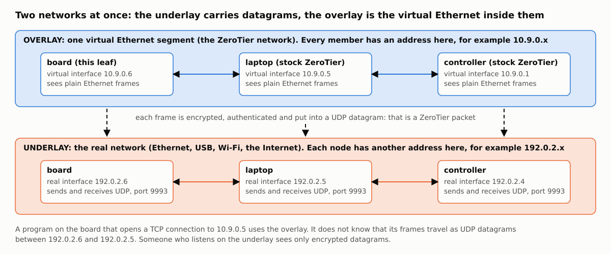
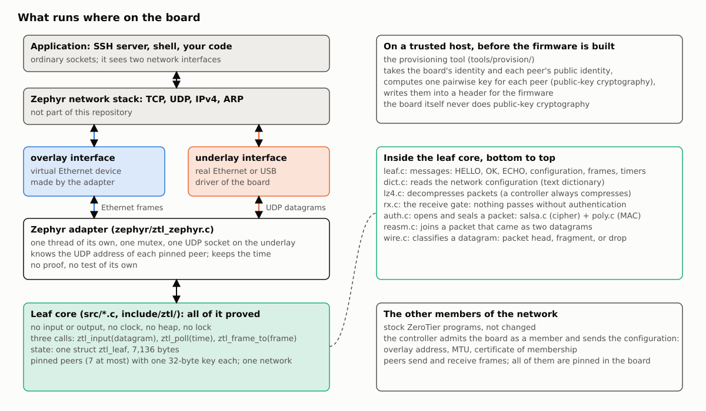
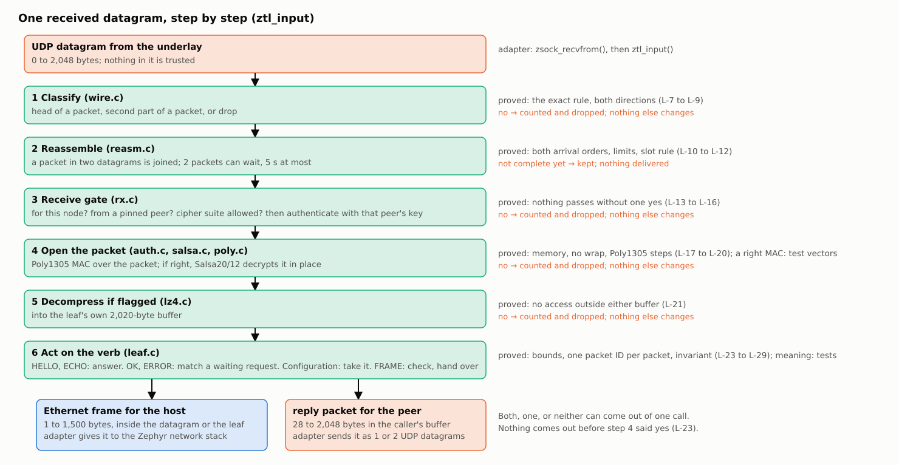

# How the leaf works: overlay, underlay, and the path of one packet

A short tutorial for a reader who knows IP networking and C, and has not used ZeroTier. Addresses in the figures are examples.

## Overlay and underlay

ZeroTier makes a virtual Ethernet network between computers that can be anywhere. Two networks are then in use at the same time.

- The **underlay** is the real network that the board is plugged into: Ethernet, USB networking, Wi-Fi, the Internet behind it. Nodes send UDP datagrams to each other there.
- The **overlay** is the virtual Ethernet segment. Each member has a second network interface with its own Ethernet address and its own IP address. Programs use that interface as they use any other.
- The link between the two: each Ethernet frame of the overlay is encrypted, authenticated, and sent inside one UDP datagram (two, if it is long) on the underlay. That datagram is a ZeroTier packet. The receiver checks it, decrypts it, and gives the frame to its own overlay interface.

Three kinds of node matter here. A **leaf** is an end point: it sends and receives its own frames and nothing else (this software). A **controller** decides who is a member of one network and sends each member its configuration: overlay address, frame size, a certificate of membership. A **peer** is any other member. This leaf talks only to peers that are written into its firmware ("pinned"), seven at most, and the controller is one of them.

## What runs where

- The **leaf core** (`src/`, `include/ztl/`) is plain computation: it has no socket, no clock, no thread, no heap. The caller gives it a datagram or a frame and a time; it answers with a frame, a packet, or nothing. This is the part with the proofs, and this form is what makes them possible: every function is "memory in, memory out".
- The **adapter** (`zephyr/`) connects the core to one operating system. It owns the UDP socket on the underlay, makes the overlay interface, keeps the time, and holds one mutex so that only one call into the core runs at a time. It has no proof.
- **Provisioning** runs on a trusted host before the firmware is built. ZeroTier nodes agree on a shared key with public-key cryptography; here the host does that once for each peer and writes the resulting 32-byte keys into the firmware. The board never does public-key cryptography, which removes most of the code and RAM of a normal node. The price: a new peer needs a new firmware.

The core has three entry points: `ztl_input()` for each received datagram; `ztl_poll()` at regular times, for the packets that are due without an outside cause (HELLO to each peer, the configuration request, the certificate); `ztl_frame_to()` for each frame that the host sends.

## One received datagram, step by step

1. **Classify.** The datagram is the head of a packet, the second part of a packet, or nothing that this leaf handles. Only sizes and a few header bytes decide; nothing is trusted yet.
2. **Reassemble.** A packet longer than one datagram comes in two parts, in any order. The leaf keeps the first part (two packets can wait, each for 5 seconds) and joins them. The result is at most 2,048 bytes.
3. **Receive gate.** The complete packet must be addressed to this node and come from a pinned peer, with a cipher suite that the leaf has. Then the gate calls the authentication with that peer's key.
4. **Open.** The packet carries a message authentication code (Poly1305) made with a key that only the two nodes have. If the code is right, the packet is decrypted in place (Salsa20/12). If not, the packet is dropped and only a counter changes. This is the line between untrusted and trusted input: everything above it in the figure is reached only by packets from a pinned peer.
5. **Decompress**, if the packet says so (a controller always compresses the configuration).
6. **Act on the verb.** Each packet has one verb. HELLO and ECHO get an answer. OK and ERROR are answers to the leaf's own requests and count only for a request that waits. A configuration from the controller is checked and taken. A frame is checked (network, size, addresses) and handed to the caller.

One call gives the caller a frame for the host, a reply packet for the peer, both, or neither. The frame is not copied: the caller gets a pointer into the datagram or into the leaf, valid until the next call.

The way out is shorter: `ztl_frame_to()` puts a frame from the host into a packet for the peer that owns the destination address, takes the next packet number (it is the nonce of the encryption, so it is never used twice), encrypts, adds the authentication code, and the adapter sends one or two datagrams.

## Where the proofs are

Each step in the last figure names the statements that are proved for it; they are listed in [PROOFS.md](PROOFS.md#list-of-proofs). In short: steps 1 to 3 are proved to follow their exact written rules; for the whole path, no step reads or writes outside its memory, no arithmetic wraps, every loop ends; and no frame and no reply leaves `ztl_input()` unless step 4 answered yes. What the messages of step 6 mean, and that step 4 answers yes only for a right code, is shown by tests against the reference implementation, not by proof. What a stock peer expects from each message: [PROTOCOL.md](PROTOCOL.md).
