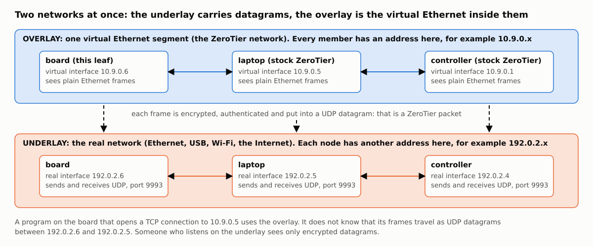
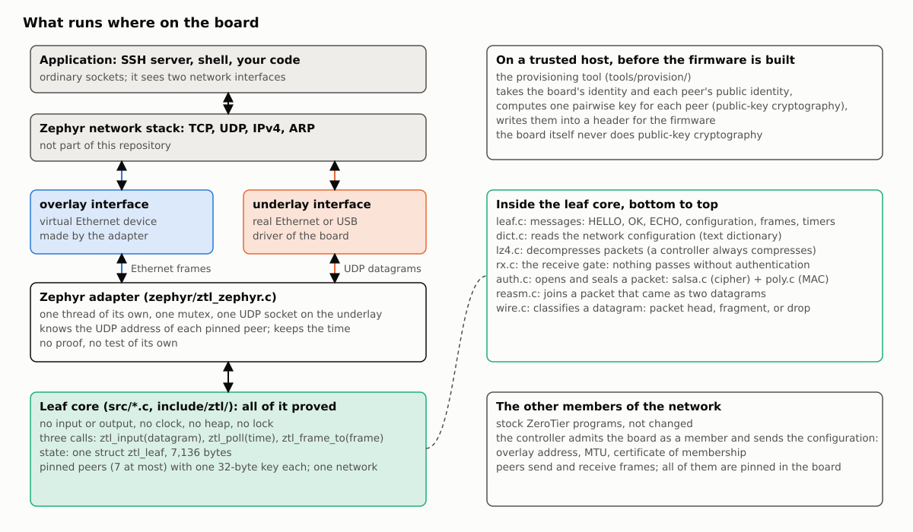
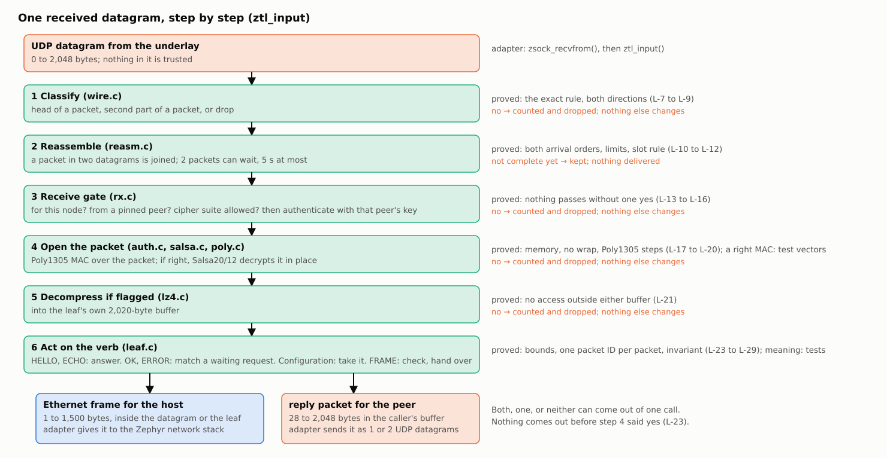
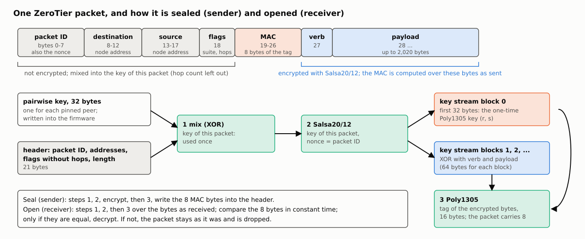

# How the leaf works: overlay, underlay, and the path of one packet

A short tutorial for a reader who knows IP networking and C, and has not used ZeroTier. Addresses in the figures are examples.

## Overlay and underlay

ZeroTier makes a virtual Ethernet network between computers that can be anywhere. Two networks are then in use at the same time.



- The **underlay** is the real network that the board is plugged into: Ethernet, USB networking, Wi-Fi, the Internet behind it. Nodes send UDP datagrams to each other there.
- The **overlay** is the virtual Ethernet segment. Each member has a second network interface with its own Ethernet address and its own IP address. Programs use that interface as they use any other.
- The link between the two: each Ethernet frame of the overlay is encrypted, authenticated, and sent inside one UDP datagram (two, if it is long) on the underlay. That datagram is a ZeroTier packet. The receiver checks it, decrypts it, and gives the frame to its own overlay interface.

Three kinds of node matter here. A **leaf** is an end point: it sends and receives its own frames and nothing else (this software). A **controller** decides who is a member of one network and sends each member its configuration: overlay address, frame size, a certificate of membership. A **peer** is any other member. This leaf talks only to peers that are written into its firmware ("pinned"), seven at most, and the controller is one of them.

## What runs where



- The **leaf core** (`src/`, `include/ztl/`) is plain computation: it has no socket, no clock, no thread, no heap. The caller gives it a datagram or a frame and a time; it answers with a frame, a packet, or nothing. This is the part with the proofs, and this form is what makes them possible: every function is "memory in, memory out".
- The **adapter** (`zephyr/`) connects the core to one operating system. It owns the UDP socket on the underlay, makes the overlay interface, keeps the time, and holds one mutex so that only one call into the core runs at a time. It has no proof.
- **Provisioning** runs on a trusted host before the firmware is built. ZeroTier nodes agree on a shared key with public-key cryptography; here the host does that once for each peer and writes the resulting 32-byte keys into the firmware. The board never does public-key cryptography, which removes most of the code and RAM of a normal node. The price: a new peer needs a new firmware.

The core has three entry points: `ztl_input()` for each received datagram; `ztl_poll()` at regular times, for the packets that are due without an outside cause (HELLO to each peer, the configuration request, the certificate); `ztl_frame_to()` for each frame that the host sends.

## One received datagram, step by step



1. **Classify.** The datagram is the head of a packet, the second part of a packet, or nothing that this leaf handles. Only sizes and a few header bytes decide; nothing is trusted yet.
2. **Reassemble.** A packet longer than one datagram comes in two parts, in any order. The leaf keeps the first part (two packets can wait, each for 5 seconds) and joins them. The result is at most 2,048 bytes.
3. **Receive gate.** The complete packet must be addressed to this node and come from a pinned peer, with a cipher suite that the leaf has. Then the gate calls the authentication with that peer's key.
4. **Open.** The packet carries a message authentication code (Poly1305) made with a key that only the two nodes have. If the code is right, the packet is decrypted in place (Salsa20/12). If not, the packet is dropped and only a counter changes. This is the line between untrusted and trusted input: everything above it in the figure is reached only by packets from a pinned peer.
5. **Decompress**, if the packet says so (a controller always compresses the configuration).
6. **Act on the verb.** Each packet has one verb. HELLO and ECHO get an answer. OK and ERROR are answers to the leaf's own requests and count only for a request that waits. A configuration from the controller is checked and taken. A frame is checked (network, size, addresses) and handed to the caller.

One call gives the caller a frame for the host, a reply packet for the peer, both, or neither. The frame is not copied: the caller gets a pointer into the datagram or into the leaf, valid until the next call.

The way out is shorter: `ztl_frame_to()` puts a frame from the host into a packet for the peer that owns the destination address, takes the next packet number (it is the nonce of the encryption, so it is never used twice), encrypts, adds the authentication code, and the adapter sends one or two datagrams.

## Step 4 in detail: authenticate, open, seal

Two questions must be answered for every packet: did a peer that holds our shared key make exactly these bytes (authentication), and can anyone else read them (encryption). ZeroTier protocol v1 answers both with two primitives by D. J. Bernstein: the stream cipher Salsa20 with 12 rounds, and the message authentication code Poly1305. The code is `src/auth.c` (how the two are put together), `src/salsa.c` and `src/poly.c`; the reference does the same in `Packet::armor()` and `Packet::dearmor()`.



**The key of one packet.** Each pair of nodes shares one 32-byte key (here: written into the firmware by the provisioning tool). It is never used directly. For each packet the first 21 key bytes are XORed with header fields: the packet ID (8 bytes), the destination and source addresses (5 + 5), the flags without the three hop-count bits (1), and the packet length (2). So the header is protected without being part of the authenticated bytes: a packet with any of these fields changed is checked under another key, and the check fails. The hop count is left out because relays change it on the way.

**Seal (`ztl_auth_seal()`, the sender).** (1) Make the key of this packet. (2) Run Salsa20/12 with that key and the packet ID as the nonce. The first 32 bytes of key stream block 0 become a Poly1305 key that is used for this packet only. (3) XOR the verb byte and the payload with the key stream from block 1 onward. (4) Compute the Poly1305 tag over those encrypted bytes and write its first 8 bytes into the header field "MAC". The order is "encrypt, then authenticate".

**Open (`ztl_auth_open()`, the receiver).** The same steps 1 and 2. Then the tag is computed over the bytes as they arrived and compared with the 8 bytes in the header, without stopping at the first difference. Only when they are equal is the payload decrypted, in place. When they differ, the packet is left exactly as it was and the answer is "no". Nothing else in the leaf ever sees a byte of a packet that did not pass this check.

**What follows from this design.**

- The packet ID is the nonce. A key stream must never be used twice under one key, so the leaf must never send two packets with the same ID. That is why "each built packet takes exactly one new packet ID" is one of the proved statements (L-25), and why the start value must be random at each start.
- Suite 0 is the same without step 3: authenticated, not encrypted. The leaf accepts it only for HELLO, as the reference does.
- The packet carries 8 of the 16 tag bytes. A forger who guesses has a chance of 2^-64 for each try.
- There is no protection against replay in protocol v1: the same sealed packet opens again ([NOT_PROVEN.md](NOT_PROVEN.md), N-7).

Proved here: `ztl_auth_open()` writes only the bytes from the verb byte onward, and after "no" the packet is unchanged (L-17); the comparison answers 1 exactly when all bytes are equal (L-20). Not proved: that "yes" means a right tag, and that seal and open are inverse (N-9, N-10, N-11); the evidence is 292 packets sealed by the reference.

References: the reference implementation, [`node/Packet.cpp`](https://github.com/zerotier/ZeroTierOne/blob/dev/node/Packet.cpp) (`armor`, `dearmor`, and the key mixing `_salsa20MangleKey`) and the description of the packet format at the top of [`node/Packet.hpp`](https://github.com/zerotier/ZeroTierOne/blob/dev/node/Packet.hpp). The same pattern (first key stream bytes as a one-time Poly1305 key, then encrypt, then tag) is the "secretbox" of NaCl: D. J. Bernstein, [Cryptography in NaCl](https://cr.yp.to/highspeed/naclcrypto-20090310.pdf).

## Salsa20 and Salsa20/12

Salsa20 is a stream cipher: from a key and a nonce it makes a long sequence of bytes that look random (the key stream), and encryption is the XOR of the data with that sequence. Decryption is the same operation.

The key stream is made in blocks of 64 bytes. For each block the cipher fills a square of sixteen 32-bit words: 4 fixed words (the text "expand 32-byte k"), 8 words of key, 2 words of nonce and 2 words of block number. Then it mixes the square with one small operation repeated many times, the quarter round: `b ^= (a + d) <<< 7; c ^= (b + a) <<< 9; d ^= (c + b) <<< 13; a ^= (d + c) <<< 18` (add modulo 2^32, rotate left, XOR). One round applies it to the four columns, the next to the four rows; two such rounds are a double round. At the end the original square is added to the mixed one, word by word, and the 64 bytes are the result. Each block is computed from its number alone, so any block can be made without the ones before it: the leaf takes block 0 for the Poly1305 key and blocks 1 onward for the payload.

**"Salsa20" without a number has 20 rounds** (10 double rounds). **Salsa20/12 has 12** (6 double rounds) and is otherwise the same; it is the variant that the eSTREAM project put into its final portfolio in 2008, as a balance between speed and margin. ZeroTier uses Salsa20/12. The best published attacks reach 8 rounds in theory (with far more work than any computer can do); none reaches 12. The margin is smaller than with 20 rounds, and that is one reason why newer ZeroTier peers prefer AES among themselves. This leaf has no AES, by design, to stay small.

In this code (`src/salsa.c`): the round count is one constant; the additions and rotations are written as arithmetic without wrap-around so that the provers can follow them (the compiler still emits one add and one rotate instruction for each). Proved: memory safety, no wrap, every loop ends. Not proved: any statement about the output (N-14); the evidence is 28 key stream vectors made by the reference, and five deliberate errors (round count, one rotation, block number) that those vectors reject.

References: D. J. Bernstein, [Salsa20 specification](https://cr.yp.to/snuffle/spec.pdf); [The Salsa20 family of stream ciphers](https://cr.yp.to/snuffle/salsafamily-20071225.pdf); [Salsa20/8 and Salsa20/12](https://cr.yp.to/snuffle/812.pdf); the [eSTREAM portfolio](https://www.ecrypt.eu.org/stream/); attacks on reduced rounds: Aumasson, Fischer, Khazaei, Meier, Rechberger, [New Features of Latin Dances](https://eprint.iacr.org/2007/472). The reference's code: [`node/Salsa20.cpp`](https://github.com/zerotier/ZeroTierOne/blob/dev/node/Salsa20.cpp).

## Poly1305

Poly1305 is a message authentication code: from a message and a 32-byte key it computes a 16-byte tag. Someone without the key cannot make the right tag for a changed message, except by a guess. The key must be used for one message only; that is why the leaf takes a new one from the key stream for every packet.

The idea is a polynomial over the numbers modulo the prime p = 2^130 − 5 (hence the name). The key is two halves: r (16 bytes, with 22 fixed bits cleared, the "clamp") and s (16 bytes). The message is cut into blocks of 16 bytes; each block is read as a number, with one extra 1 bit above its top byte (a short last block gets the 1 right after its last byte). Start with h = 0, and for each block: `h = (h + block) * r mod p`. At the end the tag is `(h + s) mod 2^128`, written as 16 bytes. That is all: one addition and one multiplication modulo p for each 16 bytes.

The difficulty is in the arithmetic: h and r have 130 bits and the processor has 32. This code (`src/poly.c`) keeps each number as five "limbs" of 26 bits. A product of two such numbers is 25 small products; because 2^130 = 5 modulo p, the parts above 2^130 fold back with a factor 5. Every one of those products and sums must fit its 64-bit or 32-bit variable, for a message of any length, or the result is silently wrong: the classic error in hand-written code of this kind.

Proved here (L-18, L-19): the limbs stay inside stated limits before and after every block, so no product, sum or carry can leave its type; and each step is exact arithmetic: five limbs stand for the same number as the 16 bytes, adding a block adds the numbers, the multiplication gives exactly `h * r − (2^130 − 5) * k` with the multiplier k named in the contract, and the last step gives the tag bytes of `(h mod p + s) mod 2^128`. Not proved: the whole function, that is, that the loop feeds every block once, that r is clamped, and that the last block is padded right (N-13); the evidence is 125 tags made by the reference, with hand-made messages where h comes out at or just above p before the last reduction, a case that random messages almost never reach.

References: D. J. Bernstein, [The Poly1305-AES message-authentication code](https://cr.yp.to/mac/poly1305-20050329.pdf) (the definition and the security bound; there the second key half comes from AES, here from the key stream); [RFC 8439](https://www.rfc-editor.org/rfc/rfc8439), section 2.5 (Poly1305 with a one-time key, with test vectors); A. Moon, [poly1305-donna](https://github.com/floodyberry/poly1305-donna) (the 26-bit limb method that the reference and this code follow). The reference's code: [`node/Poly1305.cpp`](https://github.com/zerotier/ZeroTierOne/blob/dev/node/Poly1305.cpp).

## What a stock ZeroTier node does and this leaf does not

A stock node (`zerotier-one`) is built to join any network from anywhere, to find peers it never heard of, and to pass through routers that hide it. This leaf is a fixed-function end point: one board, one network, a list of peers known when the firmware is built. Most of the difference follows from that one decision.

**Why there is no public-key cryptography on the board.** A stock node uses it for three things. (1) Key agreement: when it meets a new peer it combines its own secret key with the peer's public key (Curve25519) and gets the 32-byte key that the two then share; this is how two nodes that never met get a common secret. (2) Signatures (Ed25519): to check that a network configuration, a certificate of membership, a revocation or a list of root servers was really issued by the controller or the root that it names. (3) Its own identity: it makes its key pair at first start (with a deliberately slow hash, so that addresses are costly to forge) and proves who it is. The leaf needs none of the three at run time, because the set of peers is fixed: the result of each key agreement is a constant, so a trusted host computes it once (`tools/provision/`) and the firmware holds the 32-byte results; the leaf takes a configuration only from the one pinned controller, under that pairwise key, so the MAC of the packet stands in for the signature; and the identity is made on the host. What this saves: the Curve25519, Ed25519 and SHA-512 code and its stack. In the reference build for the same board these objects are 165,012 bytes of code (Curve25519 and Ed25519 159,184; SHA-512 5,828), against 7,694 for this whole leaf; and it would be the hardest part to prove. What it costs is in the list below.

```yaml
- left_out: "Key agreement, signatures, identity generation (Curve25519, Ed25519, SHA-512) on the device"
  a_stock_node: "meets any peer and agrees on a key; checks signatures of controllers and roots"
  consequence: >-
    A new peer needs new firmware. The firmware holds the pairwise keys: who reads the firmware
    can speak as those peers to this board. No signature of the controller is checked: the leaf
    trusts the pinned controller alone. Certificates of other members are not checked: only
    pinned peers are admitted, whatever the network says.
- left_out: "AES (AES-GMAC-SIV, protocol version 12 and later), encrypted HELLO, short-lived session keys"
  a_stock_node: "uses them with peers that have them"
  consequence: >-
    The leaf announces protocol version 11, so stock peers use Salsa20/12 + Poly1305 with it.
    One long-term key for each peer: no forward secrecy. A peer set to send encrypted HELLO
    cannot talk to the leaf.
- left_out: "Root servers, peer look-up (WHOIS), relaying through roots"
  a_stock_node: "asks the roots for unknown peers and sends through them until a direct path exists"
  consequence: "The leaf talks only to pinned peers, each at one fixed UDP address on a network that it can reach."
- left_out: "Path discovery: NAT traversal, hole punching, several paths to one peer, path quality, bonding"
  a_stock_node: "finds and keeps the best direct path, also through home routers"
  consequence: "If the peer's address or port changes, the leaf is deaf to it until the firmware changes."
- left_out: "More than 7 peers, more than one network, peers learned at run time"
  a_stock_node: "any number, limited by memory"
  consequence: "Fixed tables; RAM is known at build time (7,136 bytes)."
- left_out: "The rules engine (flow rules, capabilities, tags) and bridging"
  a_stock_node: "applies the network's rules to every frame; can bridge other Ethernet segments"
  consequence: >-
    The leaf tells the controller that it has no rules engine and gets one "accept" rule. It
    delivers frames from pinned peers to itself or to broadcast only. A network that relies on
    its rules for protection is not protected at this node.
- left_out: "IPv6 on the overlay, multicast groups other than broadcast and ARP, the list of group members"
  a_stock_node: "all of them"
  consequence: "IPv4 and ARP only."
- left_out: "Configurations in several chunks, routes, DNS, single sign-on"
  a_stock_node: "takes any size and all fields"
  consequence: "One chunk, 2,020 bytes after decompression: one address, the MTU, the certificate. Enough for a small private network."
- left_out: "Packets above 2,048 bytes and in more than two datagrams; frame sizes above 1,500"
  a_stock_node: "packets in up to 7 datagrams; frame sizes up to 10,000 bytes, 2,800 by default"
  consequence: "The network's MTU must be set to 1280..1500 on the controller (the stock default is 2800)."
- left_out: "Relaying for others, compression of what it sends, TCP fallback, trusted paths"
  a_stock_node: "has them"
  consequence: "The leaf decompresses what it gets (a controller always compresses) and never compresses."
- left_out: "Rate limits on answers; any protection against replay"
  a_stock_node: "limits the rate of some answers; has no replay protection either"
  consequence: "See NOT_PROVEN.md, N-7."
- left_out: "The service around the core: local control interface, files on disk, command-line tool"
  a_stock_node: "has them"
  consequence: "Three function calls and a status command."
```

What a stock peer still expects from the leaf, message by message: [PROTOCOL.md](PROTOCOL.md).

## Where the proofs are

Each step in the last figure names the statements that are proved for it; they are listed in [PROOFS.md](PROOFS.md#list-of-proofs). In short: steps 1 to 3 are proved to follow their exact written rules; for the whole path, no step reads or writes outside its memory, no arithmetic wraps, every loop ends; and no frame and no reply leaves `ztl_input()` unless step 4 answered yes. What the messages of step 6 mean, and that step 4 answers yes only for a right code, is shown by tests against the reference implementation, not by proof. What a stock peer expects from each message: [PROTOCOL.md](PROTOCOL.md).
